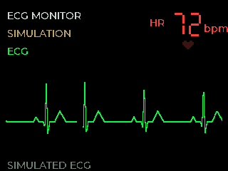

# ESP32-C3 + AD8232 心电显示装置：需求与样式交接

更新时间：2026-10-19。本文可直接交给下一个 Agent，不需要先阅读原聊天。

## 1. 用户目标与当前任务边界

用户计划把已在 STM32F103C8T6 上制作的界面移植到 **ESP32-C3**，连接 **AD8232 模块**，显示实际采集的心电波形和心率。

**请沿用本文最终样式，不要重新设计成其他监护仪布局。** 当前阶段只需心电图与心率；中文暂不添加。血氧、血压、呼吸、联网、云端、触摸菜单、临床报警均未被用户要求。

本次交接只整理资料，没有开始 ESP32-C3 移植，也没有接入 AD8232。

### 给下一位 Agent 的起始指令

> 先阅读本文件并查看附图，保留黑底、绿色全宽波形、右上角适中红色心率、约 3 秒时间窗。检查目标 ESP32-C3 开发板与现有工程，再把显示驱动和 LVGL 移植过去；先用模拟数据确认样式、方向和颜色，再接入 AD8232 的真实采样及心率处理。不要把当前固定 72 BPM 当成已实现的心率算法，也不要沿用 STM32 的 GPIO 编号。未确认的硬件信息见第 7 节。

## 2. 最终样式：以这一版为准

以上是同一份固件界面的软件渲染，非屏幕实拍。GIF 录制约 3.04 秒，循环播放。

### 用户已明确的视觉要求

- 2.4 寸屏幕，**320×240 横屏**。
- 参考医院心电监护仪的简洁视觉，但只显示心电图和心率。
- **波形放在中下部，横向完整铺开**，不要再为右侧心率保留一整列。
- **心率放在右上角，红色，适中大小**；此前占据右侧的大号绿色数字方案已被替换。
- 黑色背景，绿色心电波形；不添加花哨卡片、复杂背景或其他生理参数。
- 保留小型模拟状态标识；真实采集后改为真实状态，不允许用模拟数据冒充实时数据。
- 暂不加入中文字体，也不需要因移植平台资源更大而主动添加。
- 横向显示时间暂时维持约 **3 秒**，当前实现为 **3.04 秒**；2/5 秒切换只是此前建议，用户没有要求现在实现。

### 坐标与尺寸

以左上角为 `(0,0)`，坐标单位为像素，宽高均为逻辑横屏尺寸。

| 元素 | 位置 / 尺寸 | 说明 |
| --- | --- | --- |
| 屏幕 | 320×240 | 黑底，四周留小边距 |
| 标题 `ECG MONITOR` | `(10,14)` | 普通小字，不做大标题 |
| `SIMULATION` | `(10,39)` | 暗金色状态文字；仅模拟模式出现 |
| 波形标识 `ECG` | `(10,64)` | 绿色 |
| 波形区 | `(8,82)`，304×136 | 横向 x=8～311，纵向 y=82～217 |
| `HR` | `(210,24)` | 红色 |
| 心率绘图对象 | `(240,14)`，46×56 | 透明背景，位于右上角 |
| 当前两位数字 | 左上角约 `(242,18)`、`(265,18)` | 每位约 17×33，红色七段数码风格 |
| `bpm` | `(286,32)` | 小号红色单位 |
| 心形图标 | `(256,57)`，16×12 | 红色，随模拟 R 峰短暂点亮 |
| 底部 `SIMULATED ECG` | `(10,224)` | 小号灰绿色；真实模式改成真实状态或去掉 |

参考图与上表是布局基准。若后续三位心率需要微调右上角间距，可以在顶部范围内调整，保持波形区全宽和心率的适中大小。

### 配色与字体

| 用途 | RGB 十六进制 |
| --- | --- |
| 整体和波形背景 | `#000000` |
| 波形及 `ECG` | `#00FF40` |
| 心率、`HR`、`bpm`、点亮的心形 | `#FF4038` |
| 熄灭的心形 | `#381410` |
| 标题 | `#C8D4CD` |
| 模拟状态 | `#B8A66A` |
| 底部辅助文字 | `#6D8274` |

普通文字使用 LVGL 内置 `Montserrat 14`。心率数字用窄矩形组成七段数码字形，当前无需额外大字体。可以更换实现方式，但视觉大小、颜色和位置应接近参考图。

## 3. 屏幕参数：保留已排除的问题

屏幕由用户确认是 **ST7789、原生 240×320、四线 SPI、8 个接口**：
`GND / VCC / SCL / SDA / RST / DC / CS / BL`。**BL 已确认是逻辑输入**，当前高电平打开背光。

| 参数 | 当前正确配置 |
| --- | --- |
| 显示逻辑尺寸 | 320×240 |
| 像素格式 | RGB565，ST7789 `COLMOD (0x3A)=0x55` |
| 方向寄存器 | `MADCTL (0x36)=0xA0`，即 MY+MV |
| 反色 | **关闭**，发送 `INVOFF (0x20)` |
| 地址偏移 | X=0、Y=0 |
| SPI | Mode 0、MSB first、8 位；当前 12 MHz |
| 像素传输字节序 | RGB565 高字节先传 |

用户曾反馈“白色背景、红色波形”，关闭反色后确认颜色正确。用户还要求横屏再旋转 180°，最终方向是 `0xA0`，不是更早的 `0x60`。迁移时优先保留最终寄存器效果，不能只照抄某个库的 `rotation=1` 编号；不同库的旋转枚举不同。

当前 `LV_COLOR_16_SWAP=1`。迁移后根据新 SPI/LCD 库核对，**只做一次字节交换**。如果后端已经交换，就不能再叠加；不要靠反色命令解决字节序或 RGB/BGR 顺序问题。也不要同时使用硬件旋转和等效的软件旋转，造成二次翻转。

`SCL/SDA` 在本模组上是 SPI 时钟和 MOSI，不是 I²C。显示不使用 MISO。

### 当前 STM32 接线，仅供追溯

| 屏幕 | STM32F103C8T6 |
| --- | --- |
| VCC / GND | 3.3V / GND |
| SCL / SDA | PA5 / PA7 |
| CS / DC | PB0 / PB1 |
| RST / BL | PB10 / PB11 |

以上引脚**不是 ESP32-C3 的接线方案**。ESP32-C3 引脚需要根据实际开发板重新分配，避开启动配置、板载 Flash、USB/串口及板载外设冲突。

## 4. 当前代码实际完成了什么

当前工程目录：`E:\STM32CubeIDE\workspace_1.17.0\2.4SPI`。

| 文件 | 用途 |
| --- | --- |
| `Core/Src/lvgl_port.c` | 最终界面、绘图回调、显示刷新、扫描历史、心形闪烁 |
| `Core/Inc/st7789.h` | 分辨率、方向、反色、偏移、背光参数 |
| `Core/Src/st7789.c` | ST7789 初始化和 SPI 像素写入 |
| `Core/Inc/lv_conf.h` | LVGL 8.3.11 裁剪配置 |
| `Core/Src/ecg_sim.c`、`Core/Inc/ecg_sim.h` | 整数插值模拟波形，默认约 72 BPM |
| `Core/Src/main.c` | 初始化、主循环调用 LVGL |
| `Core/Src/spi.c`、`gpio.c` | 当前 STM32 外设初始化 |
| `Tests/host/lvgl_smoke.c` | 原生 LVGL 渲染与刷新回归测试 |
| `Tests/host/run.ps1`、`render_preview.py` | 本机测试及 PNG/GIF 生成 |
| `Drivers/lvgl/UPSTREAM.md` | LVGL 上游版本与来源 |
| `Build/2.4SPI.hex` | 当前 STM32 固件，不能烧到 ESP32-C3 |

当前 LVGL 为 **v8.3.11**，上游 commit：`74d0a816a440eea53e030c4f1af842a94f7ce3d3`。
仅启用标签和基础对象，`LV_USE_CHART=0`、`LV_DRAW_COMPLEX=0`。波形和心率通过绘图事件中的窄矩形绘制，移植不必强行改用 chart 控件。

### 当前显示与时序

- 模拟源每 10 ms 生成一个显示点，即 100 点/秒。304 个横向像素对应 3.04 秒。
- 波形是**从左向右循环覆盖的扫描式显示**，前方保留 8 像素缺口；不是每帧把全部历史向左搬动。
- 定时器约每 40 ms 更新一次，主循环约每 5 ms 调度 LVGL。
- 波形历史为 304 个 `int16_t`，约 608 字节；基线当前在波形对象内 y=88，即屏幕 y≈170。
- 绘图缓冲是 320×6 个 RGB565 像素，即 3840 字节，单缓冲；LVGL 内存池为 8 KB。
- SPI 发送目前是阻塞的，数据传完才调用 `lv_disp_flush_ready()`。ESP32-C3 若改成 DMA 异步发送，应在传输真正完成后通知 LVGL，不能提前复用缓冲。
- 心形亮起约 120 ms。当前触发条件只是模拟幅度跨过阈值，不是真实信号的 R 峰检测算法。
- 当前 `draw_hr()` 从 `ECG_SIM_BPM` 绘制两位数字；**仍是常量 72，不会从采样计算心率**。

### 已有验证与未验证事项

当前最终布局：STM32 Debug 编译通过，Flash 使用 61752 字节，RAM 使用 16400 字节（含链接脚本预留堆栈）。

软件渲染模拟运行 60 秒，验证了红色小号心率、心形亮灭、扫描绕回、刷新范围和内存完整性；局部更新与完整重绘的逐像素结果一致，未出现持续堆增长。

用户已在实屏确认更正后的颜色和横屏方向。**最新版布局本身有软件预览与编译结果，没有收到最新版实屏照片。** ESP32-C3、AD8232、真实心率准确性和人体测量均未验证，不可把这些写成已完成。

## 5. 移植时必须替换的部分

### 显示与运行平台

1. 先确认目标工程框架。已有 ESP-IDF/Arduino/PlatformIO 工程时沿用其实际结构；未选框架时可优先考虑 ESP-IDF，但这不是用户已指定的版本或框架。
2. 为 ESP32-C3 重新配置 SPI、CS/DC/RST/BL 和对应 GPIO。
3. 把 STM32 HAL 的时间、延时、GPIO、SPI 操作替换成目标框架实现。
4. 尽量先固定 LVGL 8.3.11 复现界面。若目标依赖要求 LVGL 9，明确进行 API 移植，不要混用 8/9 的配置与接口。
5. LVGL 调用集中在同一 UI 任务或按所用移植层加锁。ADC 中断/回调只传递数据和通知，不直接刷新 LVGL。
6. 采集、处理和显示通过环形缓冲或队列解耦。SPI 刷新不能决定 ADC 采样时刻，也不能因界面卡顿而悄悄改变时间轴。

### AD8232 接口与 ADC

AD8232 是模拟信号调理前端，**不是直接输出数字 ECG 的 SPI/I²C 传感器**；其模拟输出需要进入 ESP32-C3 ADC。模块的增益、偏置、滤波和输出范围取决于具体电路，需要核对实物/原理图。[AD8232 官方资料](https://www.analog.com/en/products/ad8232.html)

- AD8232 `OUT/OUTPUT` → 合适的 ADC 输入；模块数字地与 ESP32-C3 系统地按设计连接。模块若引出 `LO+ / LO-`，可用 GPIO 读取导联脱落状态；`SDN` 若引出，按模块资料设定。
- 不要把 RA/LA/RL 电极端接到普通 GPIO，也不要把 RL/RLD 当作系统 GND。
- 先确认供电和 OUT 的实际电压范围。不能因为模块使用 3.3V 电源，就假定 C3 ADC 在任意衰减设置下都能准确覆盖 0～3.3V；校准也不能扩大硬件输入范围。
- 优先研究 ADC1 的可用引脚；不要照搬原版 ESP32/S3 的引脚、衰减或采样代码。C3 的 ADC2 DMA 有已知限制，不能忽略。[C3 连续 ADC 文档](https://docs.espressif.com/projects/esp-idf/en/stable/esp32c3/api-reference/peripherals/adc/adc_continuous.html)
- 根据所选 SDK 的限制决定定时 oneshot 或连续采样。连续模式的可用频率范围需要查该目标 SDK 的 `soc_caps.h`，不要未经确认直接设置成 100/250/500 Hz；必要时在支持的硬件速率上采集，再按明确的处理方案降采样。
- 配置合适的 ADC 衰减和校准，记录输入范围、采样周期、丢样情况与原始数据。转换为 ADC 引脚电压并不等于已经得到电极端的 mV；还需要确认模块增益和偏置。[C3 ADC 校准文档](https://docs.espressif.com/projects/esp-idf/en/stable/esp32c3/api-reference/peripherals/adc/adc_calibration.html)

### 采样、显示与心率：不要混淆

**3 秒是显示时间窗，不是 3 秒才采一次，也不意味着 ADC 必须是 100 Hz。** 当前的 100 点/秒只是模拟演示的显示节奏。

真实采样率及滤波参数由下一位 Agent 结合 AD8232 模块带宽、SDK 和用途确定，写成配置并说明依据。显示层把约 3 秒数据映射到 304 列：压缩多个采样到一列时，建议保留该列的最小/最大值以免漏掉尖峰，不能简单任取一个点或仅取平均。

显示用的幅度缩放/去偏置与心率检测分开。限幅用于防止画面越界，不能悄悄把 ADC 饱和数据当作有效 ECG；有异常应保留状态。未标定前不显示虚假的 `mV` 或标准纸速。

真实心率应来自经过验证的 R 峰/RR 间期处理，不能继续使用固定 `72` 或直接照搬模拟阈值 `>30`。需要验证噪声、运动干扰、断线和重新接入时的行为；以信号源/参考数据测试并记录结果，不能只凭波形“看起来像”判断正确。

## 6. 真实采集时需要补齐的显示行为

以下是移植到真实采集时要处理的工程事项，**不是当前模拟版已经实现的功能**：

- 有效信号时显示计算出的心率；数值可以适度平滑，但不要掩盖无效状态。
- 未形成有效心率、数据超时、导联脱落或信号明显无效时显示 `--`，清除过期数字，暂停心跳图标；不要继续显示 72 或最后一个“正常”值。
- 在顶部原状态位置简短标注如 `LIVE`、`LEADS OFF`、`NO SIGNAL`。这些是建议英文状态名，可结合模块功能调整。
- 测量值应支持三位数字；当前两位字形只适合本次模拟。保持数字约当前高度，必要时在顶部调间距，不挤占全宽波形。
- 数据源切换、滤波重置、掉线和重新接入时，明确清理旧心率/旧历史，避免模拟曲线与真实曲线混在一起。
- `DEMO/SIMULATION` 与真实采集模式明确分开。测试模式可保留，但断线后不能自动用假波形填充还显示成实时。
- 心形若保留，应跟随接受到的有效心搏事件，而非独立固定定时器假闪烁。

## 7. 尚未确认的信息

下一位 Agent 在分配硬件引脚或设置采样前应从目标工程、板卡资料或用户处确认：

| 待确认项 | 为什么需要 |
| --- | --- |
| ESP32-C3 开发板准确型号和可用引脚 | 避开板载外设、启动和下载接口冲突 |
| ESP-IDF/Arduino/PlatformIO、版本及已有工程 | 决定 ADC/SPI/LVGL 的实际 API |
| 是否继续使用这块已调好的 ST7789 模组 | 换屏后方向、反色、偏移可能不同 |
| AD8232 模组型号、原理图及实际引出引脚 | 确认输出范围、滤波、增益和脱落检测 |
| 电源、USB/充电/调试/其他仪器的连接方式 | 明确人体接触电路的电气路径 |
| 首次调试的信号源或参考数据 | 让采集/算法先有可重复的验收依据 |

未明确的 ESP32-C3 GPIO 编号、ADC 衰减、采样率、滤波系数、RR 判定范围均不得写成用户已确认的要求。

## 8. 实物测量前的边界

AD8232 模组本身不等于完整的人体保护或隔离系统。Analog Devices 的评估指南建议先使用 ECG 信号源评估，并说明输入限流电阻并不构成完整保护，供电/采集设备仍可能引入漏电路径。[官方 UG-514，第 1 页](https://www.analog.com/media/en/technical-documentation/user-guides/AD8232-EVALZ_UG-514.pdf)

后续先用信号源完成采集和显示验证。涉及人体前，应由具备相应能力的人检查完整电路及隔离方案；不能把非隔离 USB、充电器、调试器或接地示波器直接引入人体电极回路，也不能把“用电池”当作完整安全保证。当前项目没有医疗用途验证，不应输出临床诊断结论。

## 9. 建议交付顺序与验收

1. **复现界面**：ESP32-C3 用模拟数据显示最终样式，颜色/方向与附图一致；心率在右上角，波形保持中下部全宽，约 3 秒，不主动增加其他参数。
2. **打通采集**：用合适信号源接 AD8232，得到带时间基准的原始 ADC 数据，验证输出范围、稳定采样和丢样处理。
3. **处理与显示解耦**：接入滤波、显示列聚合和幅度映射；改变 UI 刷新负载不应改变采样频率或压坏波形峰值。
4. **实现心率与状态**：移除真实模式里的固定 72，支持有效性、超时、脱落及恢复；三位心率不破坏布局。
5. **交付可复现工程**：说明板型、接线、SDK/库版本、构建烧录方法、配置参数、信号源测试结果及尚未验证事项。明确区分已编译、已上板和已验证采集/算法。

UI 回归至少覆盖扫描跨右边界后的擦除、心形亮灭、无效心率、长时间内存稳定性；可复用现有软件渲染测试思路。人体测量不是本模拟版测试结论的一部分。

## 10. 参考链接与交接附件

- [LVGL v8.3.11 源码](https://github.com/lvgl/lvgl/tree/v8.3.11)
- [LVGL 8 显示接口](https://docs.lvgl.io/8.3/porting/display.html)
- [ST7789V 数据手册](https://dl.espressif.com/dl/schematics/ST7789V_SPEC_V1.0.pdf)
- [AD8232 官方资料](https://www.analog.com/en/products/ad8232.html)
- [AD8232 评估指南 UG-514](https://www.analog.com/media/en/technical-documentation/user-guides/AD8232-EVALZ_UG-514.pdf)
- [ESP32-C3 ADC oneshot](https://docs.espressif.com/projects/esp-idf/en/stable/esp32c3/api-reference/peripherals/adc/adc_oneshot.html)
- [ESP32-C3 ADC continuous](https://docs.espressif.com/projects/esp-idf/en/stable/esp32c3/api-reference/peripherals/adc/adc_continuous.html)
- [ESP32-C3 ADC calibration](https://docs.espressif.com/projects/esp-idf/en/stable/esp32c3/api-reference/peripherals/adc/adc_calibration.html)

官方 `stable` 链接会随版本变化，移植时以目标工程实际 SDK 的对应版本文档为准。

推荐一起提供本 Markdown、`docs/handoff/` 下的 PNG/GIF，以及第 4 节列出的参考源码。只收到本文时，也可以凭坐标表和参数复现界面；参考源码包含 STM32 HAL 依赖，不能直接当作 ESP32-C3 工程编译。
